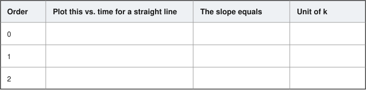
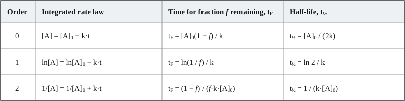

## What this guide is for

This guide shows how to do a reaction kinetics analysis in R, using a
general approach that carries from raw concentration-time data to a rate
constant, then uses that rate constant to predict a concentration at a
future time or the time to reach a given concentration (e.g. shelf life),
and finally goes from rate constants at several temperatures to an
activation energy and a rate constant extrapolated to a new temperature.

Work through each step with your own concentration-time dataset,
substituting your own column names wherever the code refers to `time` or
`concentration`. Some code is complete; some has blanks marked `___` for
you to fill in. The basic R mechanics
(assignment, `mutate()`, `filter()`, `lm()`, plotting) are covered in the
introductory R guide and are not re-explained here, so work through that
guide first.

## Setting up

```{r}
#| message: false
library(tidyverse)
```

Import your dataset the way you already know from the introductory R
guide: `read_csv()`, then `glimpse()` to see what columns you actually
have before doing anything else.

```{r}
#| eval: false
kinetics_data <- read_csv("_______")   # fill in your file's path/name
___(kinetics_data)   # glimpse at the data before doing anything else
```

## Part 1: Determining the reaction order

### Looking at the data

Before fitting anything, plot the raw data:

```{r}
#| eval: false
ggplot(kinetics_data, aes(x = ___, y = ___)) +   # map time to x, concentration to y
  geom_point()
```

Feel free to style the plot to make it more readable, using what the
intro guide covered: axis titles with units, adding a theme, and
adjusting point size and transparency with `alpha`.

### Working out the linearizations, on paper first

Each reaction order (0th, 1st, 2nd) has an integrated rate law that becomes
a straight line under a specific transformation of concentration. Before
writing any code, fill in the table below:

{width=100%}

This table is what the code in the next step is actually built from. If a
line in the code below doesn't make sense, it usually means this table is
worth revisiting.

### Creating the transformed columns

With the table above filled in, each transformation can be added as its
own column, using `mutate()` as covered in the intro guide. All three are
created here so the fits in the next step can be compared directly,
without needing to decide on the correct order in advance.

```{r}
#| eval: false
kinetics_data <- kinetics_data %>%
  mutate(
    order_0 = concentration,   # 0th order is linear in [A] itself, so no transform
    order_1 = ___,             # transform of concentration for a 1st order plot
    order_2 = ___              # transform of concentration for a 2nd order plot
  )
```

### Fitting a line to each transformation

Each of the three transformed columns can now be fitted against time with
`lm()`. The first is done for you below; the other two follow the same
pattern, just applied to a different column.

```{r}
#| eval: false
lm_0 <- lm(order_0 ~ time, data = kinetics_data)
lm_1 <- ___   # same pattern as lm_0, fitted to order_1 instead
lm_2 <- ___   # same pattern again, fitted to order_2
```

Writing out three near-identical `lm()` calls is not the most efficient way to do
this. Whenever you find yourself copying a line and changing just one
word, there is usually a way to have the code do the repeating for you.
That approach is left aside here to keep the focus on the chemistry — for
three fits, the copy-paste version is perfectly fine.

### Comparing the fits

R² gives a way to compare how well each of the three lines fits its data.
Extract the R² from the three models and print them with the `cat()`
function (the first example is given).

```{r}
#| eval: false
r2_0 <- ___   # pulled from summary(), same as in the intro guide
r2_1 <- ___
r2_2 <- ___

cat("R2 (0th order):", signif(r2_0, 3), "\n")
cat("R2 (1st order):", ___, "\n")   # same signif() pattern as the line above
cat("R2 (2nd order):", ___, "\n")
```

The R² values point to one order, but don't rely on them alone. Plot all
three transformations against time with their fitted lines and look for
the one where the points sit randomly around the line, with no curve.

```{r}
#| eval: false
ggplot(kinetics_data, aes(x = time, y = order_0)) +
  geom_point() +
  geom_smooth(method = "lm", se = FALSE) +
  labs(x = "Time (___)", y = "___") +
  theme_minimal()
```

Repeat for `order_1` and `order_2`, then compare the three plots before
deciding on an order.

### From slope to rate constant

The rate constant, `k`, is the slope of the winning fit, up to a sign
that depends on the reaction order — check what you wrote in the table
above. `coef(model)[[2]]` pulls the slope out of a fitted model.

```{r}
#| eval: false
# first blank: leave empty, or put a minus sign, depending on the order
# second blank: the lm object for the winning order
k <- ___coef(___)[[2]]
```

## Part 2: Using the rate constant

A rate constant on its own rarely answers a practical question directly;
it needs to be combined with the correct rearranged form of the rate law
for that order. Two questions come up constantly in stability work, and
they are mirror images of each other: given `k`, how long until a
certain fraction is left, and given `k`, how much is left after a
certain time.

### Time to reach a given fraction remaining

This is a **shelf-life calculation**: the time until only a certain
fraction of the original amount is left. It comes up constantly in
pharmaceutical stability work under specific names — t90 (90% remaining),
t50 (50% remaining, also called the half-life), and so on — but they are
all the same calculation with a different `fraction_remaining`.

Each integrated rate law can be rearranged for the time `t_F` at which a
fraction *f* = [A]/[A]₀ of the original amount is left. The half-life is
just the special case *f* = 0.5. For 0th and 2nd order the initial
concentration, [A]₀, also enters.

{width=100%}

From the same `t_F` expression you can work out the shelf life t₉₀ — the
time until 90% remains — by setting *f* = 0.9. Do this for each order so
you have those three formulas alongside the half-life ones.

As a fully worked example, here is the half-life of a **first-order**
reaction calculated in R. For first order, `t_F = ln(1/f) / k`, so with
*f* = 0.5 the formula is `log(2) / k` (`log()` is the natural logarithm
in R):

```{r}
#| eval: false
k_example <- 0.0031          # a first-order rate constant, in units of 1 / time

t_half <- log(2) / k_example

cat("Half-life:", signif(t_half, 3), "units of time", "\n")
```

Now do the same for your own reaction: pick the `t_F` formula for your
order, substitute the fraction you want (0.5 for the half-life, 0.9 for
t₉₀), and compute it with your own `k` (and `[A]₀`, if your order needs
it).

```{r}
#| eval: false
fraction_remaining <- ___   # e.g. 0.9 for t90, 0.5 for t50 (half-life)

t_answer <- ___   # the t_F formula for your order, evaluated at fraction_remaining

cat("Time to reach", fraction_remaining*100, "%:", signif(t_answer, 3), "units of time", "\n")
```

### Amount remaining after a given time

This is the reverse question: instead of solving the rearranged rate law
for time, solve it for concentration. You need the same rate constant
`k`, the reaction order from Part 1, and the initial concentration.

As a fully worked example, here is the calculation for a **second-order**
reaction. The integrated rate law is `1/[A] = 1/[A]₀ + k·t`; solving that
for `[A]` gives `[A] = 1 / (1/[A]₀ + k·t)`:

```{r}
#| eval: false
initial_conc <- 0.050    # [A]0, in mol/L
k_example    <- 0.012    # second-order rate constant, in L/(mol*time)
elapsed_time <- 30       # t, in the same time units as k

conc_at_t <- 1 / (1/initial_conc + k_example * elapsed_time)

cat("Concentration remaining after", elapsed_time, "units of time:", signif(conc_at_t, 3), "\n")
```

## Part 3: Temperature dependence and Arrhenius extrapolation

Some questions give you a rate constant measured at several temperatures,
rather than a concentration-time series. The goal there is to determine an
activation energy from that data, and use it to estimate the rate constant
at a temperature that wasn't directly measured.

### Importing and preparing the data

Temperature-dependence data is often small — just a handful of rate
constants, one per temperature. If it comes as a `.csv`, import it the
same way as before:

```{r}
#| eval: false
temp_data <- read_csv("_______")   # fill in your file's path/name
```

If instead the values are given to you in a table or in the question
text, it is just as easy to type them straight into a data frame with
`tibble()`, one column per variable:

```{r}
#| eval: false
temp_data <- tibble(
  temp_C = c(25, 35, 45, 55),      # temperature in °C
  k      = c(___, ___, ___, ___)   # the matching rate constants
)
```

As with reaction order, there is a specific transformation of temperature
and of the rate constant that produces a straight line here. This can be
seen in the Arrhenius equation, usually written in the form

$$k = A \, e^{-E_a / (R\,T)}$$

where `A` is the pre-exponential factor, `E_a` the activation energy, `R`
the gas constant, and `T` the absolute temperature. Taking the natural
log of both sides linearises it:

$$\ln k = \ln A - \frac{E_a}{R} \cdot \frac{1}{T}$$

This linearized form tells you which transformations to apply to get a
straight line. Consider what its slope and intercept represent.

```{r}
#| eval: false
temp_data <- temp_data %>%
  mutate(
    temp_K = ___,   # convert your temperature column to Kelvin
    inv_T  = ___,   # 1/T
    ln_k   = ___    # natural log of your rate constant
  )
```

### Fitting and extracting the activation energy

With `inv_T` and `ln_k` created, fitting a line and pulling out its
coefficients follows the same pattern already used in Part 1 and in the
intro guide. From there, the slope and intercept need to be converted into
an activation energy and a pre-exponential factor — the linearized
Arrhenius equation above shows how.

```{r}
#| eval: false
lm_temp <- lm(___)   # ln_k as a function of inv_T, same lm() syntax as Part 1

slope     <- coef(lm_temp)[[___]]   # remember: [[1]] is the intercept, [[2]] is the slope
intercept <- coef(lm_temp)[[___]]

R_gas <- 8.314   # J / (mol K)
Ea <- ___        # activation energy in kJ/mol, extract relationship from Arrhenius equation
A  <- ___        # pre exponential factor, what is the unit?
```

### Handling multiple conditions (e.g. several pH values)

Say you ran your temperature series not once, but under a few different
conditions — for example at several pH values — and you now want an
activation energy for each. Typically all of those measurements end up in
the same data frame, with an extra column saying which condition each row
belongs to (a `pH` column, in this case).

Because each condition can degrade with its own activation energy, you
don't fit one line through all the rows at once. Instead you repeat the
fit above once per condition, using the values in that extra column to
split the data.

First, check what the `pH` column actually contains — the exact values
matter, since they're used for an exact match below:

```{r}
#| eval: false
unique(temp_data$pH)   # list the distinct values in the pH column
```

`unique()` is new here: given a column, it returns each distinct value
that appears in it, once. It's a quick way to find out exactly how a
category is spelled/formatted before filtering on it. Suppose this turns
up two values, `"pH 6.00"` and `"pH 8.00"`.

With the exact values known, `filter()` picks out just the rows for one
pH, and that filtered subset is passed straight into `lm()` — the rest of
the fit is identical to the single-condition version above, just run once
per pH. The first fit is filled in for the `"pH 6.00"` rows; the second
follows the same pattern:

```{r}
#| eval: false
lm_temp_pH6 <- lm(ln_k ~ inv_T, data = filter(temp_data, pH == "pH 6.00"))
lm_temp_pH8 <- lm(ln_k ~ inv_T, data = filter(temp_data, ___ == ___))  # pH 8.00

slope_pH6     <- ___
intercept_pH6 <- ___
# ...repeat for pH8

Ea_pH6 <- ___   # same relationship as before, applied to slope_pH6
# ...repeat for pH8
```

> **Note:** `filter()` is used directly inside `lm()`'s `data = ` argument
> here, rather than assigned to its own object first with the pipe. Both
> approaches do the same thing — this is just a shorter way to write it
> when the filtered result is only needed once.

Whatever question the data was collected to answer usually comes down to
comparing the conditions against each other — for example, which one has
the larger rate constant (and is therefore less stable) at a given
temperature. The same extrapolation approach from the next section, run
once per condition, gives a value of `k` for each condition at that
temperature, which can then be compared directly with `>`/`<` as covered
in the intro guide.

### Visualising the Arrhenius plots by condition

With two pH levels in `temp_data`, both Arrhenius lines can be drawn on
one plot by mapping `color` to the `pH` column *inside* `aes()`:

```{r}
#| eval: false
ggplot(temp_data, aes(x = inv_T, y = ln_k, color = pH)) +
  geom_point() +
  geom_smooth(method = "lm", se = FALSE) +
  labs(x = "1 / T  (1/K)", y = "ln k", color = "pH") +
  theme_minimal()
```

The key point is *where* `color` goes. Set inside `aes()`, it is a
**mapping**: ggplot looks at the `pH` column, gives each distinct value
its own colour, and draws a separate coloured series for every layer that
inherits this `aes()` — so `geom_point()` splits into two sets of points
and `geom_smooth()` fits a separate line per pH, one regression through
each group rather than one through all the rows. A legend is added
automatically. By contrast, a fixed setting like `color = "red"` placed
*outside* `aes()` colours every point the same and does no grouping — it
is a value, not a mapping.

Two roughly parallel lines mean a similar activation energy at both pH
values; a clear difference in slope means the activation energies differ.

### Extrapolating to a new temperature

The fitted line can be used to estimate `k` at a temperature not present
in the original data, without needing to measure it directly. The route
is: convert the target temperature to `1/T` (the same transform as
`inv_T`), read the fitted line at that point to get `ln k`, then undo the
`log()` with `exp()`.

As a worked example, here is `k` estimated at 25 °C from a fitted line,
using its slope and intercept — shown here for the `lm_temp_pH6` fit:

```{r}
#| eval: false
T_new_K     <- 25 + 273.15       # 25 °C in Kelvin
inv_T_new_K <- 1 / T_new_K       # same transform as inv_T

ln_k_new <- slope_pH6 * inv_T_new_K + intercept_pH6   # the fitted line, y = m*x + c
k_new    <- exp(ln_k_new)                             # undo the log() from mutate()

cat("Estimated k at", T_new_K, "K:", signif(k_new, 3), "\n")
```

The same code works for any target temperature (change `T_new_K`) and for
any fit — swap in the slope and intercept of the model you want, e.g.
`slope_pH8` / `intercept_pH8`, or plain `slope` / `intercept` from a
single-condition fit.
